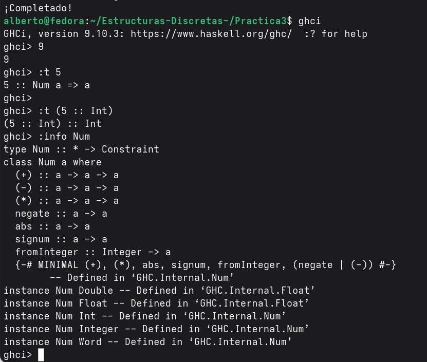

**Objetivo de la practica:** Intruducir al estudiante a las listas por comprension con ejercicios y resolver sus dudas investigando fuera del internet. 

**Tiempo requerido:** 5 horass

**Ejercicio favorito : ** Cetes, porque usamos otra forma de recibir los datos lo que nos da mas libertad por agregar mas variantes, maybe semanas o anios

**Comentarios**: se me complicaron las listas de comprension, como es un tema relativamente apenas use, pues se me complica poner las condiciones, preferiria hacerlo recursivamente, de hecho uno lo hize asi recursivo y ya no lo borre porque funcionaba 

**Principal diferencia entre Num y Int en haskell**
    La principal diferencia es la especificación de lo que quieras, cuando hablas de un Num en haskell te refieres al papá de los pollitos osea cualquier tipo de número definido en la memoria, algunos ejemplos son , Double, Float e Int, siendo el último un tipo de dato concreto real con valor asignado en la memoria pero cuando hace refencia a Num es cualquier tipo de dato predefinido

